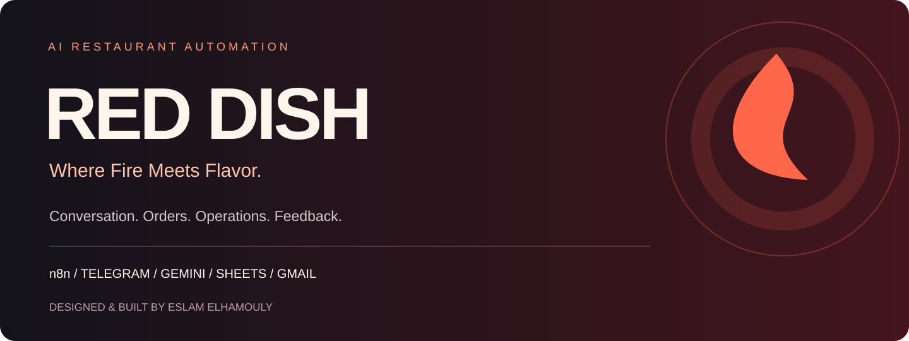
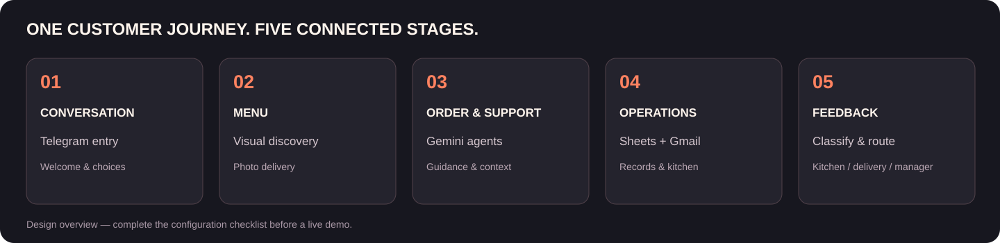
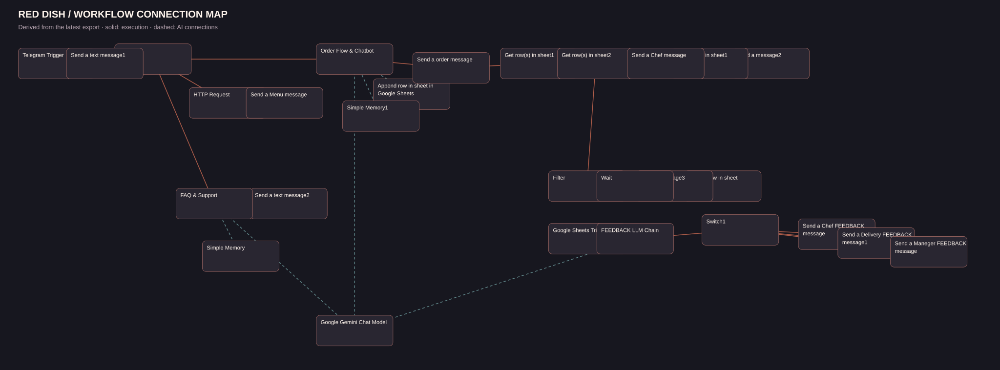

<p align="center"></p>

<p align="center"><strong>From the first message to the feedback that improves the next meal.</strong><br/>n8n · Telegram · Google Gemini · Google Sheets · Gmail</p>
<p align="center"><a href="docs/SETUP.md">Setup guide</a> · <a href="docs/ARCHITECTURE.md">Architecture</a> · <a href="docs/DEMO.md">Demo walkthrough</a> · <a href="README.ar.md">بالعربي</a></p>

## The idea

Taking an order is only the beginning. Restaurants also need to share menus, answer questions, coordinate the kitchen, and understand customer feedback.

**RED DISH** connects those steps in an n8n automation prototype for a fictional spicy-food restaurant. Telegram handles the conversation, Gemini powers ordering and support agents, Google Sheets holds operational records, and Gmail connects the workflow to the people handling orders and feedback.

**Status: portfolio prototype.** The supplied exports require credentials, spreadsheet mappings, and routing configuration. See the [configuration gaps](docs/SETUP.md#configuration-gaps) before activation. End-to-end execution has not been verified in this documentation update.

## The customer journey



| Stage | Purpose | Implementation in the latest export |
| --- | --- | --- |
| **01 · Conversation** | Welcome customers and offer their next step. | Telegram trigger, greeting, and Switch. |
| **02 · Menu** | Deliver a visual menu inside the chat. | HTTP image request and Telegram photo node. |
| **03 · Order & support** | Guide meal selection and answer restaurant questions. | Two Gemini-backed agents with separate memory nodes. |
| **04 · Operations** | Connect confirmed orders to records and kitchen communication. | Sheets append tool, lookups, Gmail, and status updates. |
| **05 · Feedback** | Follow up after delivery and direct concerns to the right team. | A 60-minute Wait path; a separate feedback sheet trigger, LLM chain, and routing Switch. |

The graphic shows the intended journey. The exported wiring has setup gaps described below and in the architecture guide.

## Where AI adds value

- **Guided ordering:** the prompt presents menu items and prices, asks one question at a time, and requests explicit confirmation before using the Sheets tool.
- **Conversational support:** a dedicated agent uses restaurant details in its prompt to answer questions about hours, location, and spice levels.
- **Feedback triage:** a Gemini chain is instructed to classify ratings into four labels, which a Switch maps to operational email branches.
- **Conversation context:** memory nodes support ordering and FAQs. Their fixed session keys need per-customer configuration.

| Feedback label | Intended destination |
| --- | --- |
| `POSITIVE` | No negative alert; no downstream node connected. |
| `NEGATIVE_KITCHEN` | Kitchen feedback email. |
| `NEGATIVE_DELIVERY` | Delivery feedback email. |
| `NEGATIVE_BOTH` | Manager feedback email. |

The prompt treats ratings of **6 or below** as issues. The current food question measures *spiciness*, so revise or interpret that scale before treating it as overall satisfaction. Classification helps triage; it does not prove the root cause.

## Get started

```bash
git clone https://github.com/elhamoli/ai-automation.git
cd ai-automation
```

1. In n8n, open the workflow menu and choose **Import from File**.
2. Select [`RED DISH last.json`](RED%20DISH%20last.json), the latest supplied export.
3. Follow [SETUP.md](docs/SETUP.md) to connect accounts and complete the mappings and routing.
4. Work through the [demo checklist](docs/DEMO.md) with test accounts before activation.

[Official n8n import instructions](https://docs.n8n.io/workflows/export-import/).

## Inside the repository

| File | Purpose |
| --- | --- |
| [`RED DISH last.json`](RED%20DISH%20last.json) | Latest export: **33 nodes**, including five explanatory sticky notes. |
| [`RED DISH (1).json`](RED%20DISH%20%281%29.json) | Earlier export: **24 nodes**, retained for reference. |
| [`docs/SETUP.md`](docs/SETUP.md) | Accounts, sheet headers, and configuration gaps. |
| [`docs/ARCHITECTURE.md`](docs/ARCHITECTURE.md) | Actual connections and implementation boundaries. |
| [`docs/DEMO.md`](docs/DEMO.md) | Walkthrough with expected checks. |
| [`examples/`](examples/) | Synthetic CSV records for preparing demo sheets. |
| [`assets/`](assets/) | Original repository artwork and a map derived from the workflow JSON. |

## See the workflow



This diagram uses the exported node positions and connections. Solid lines show execution paths; dashed lines show model, memory, and tool connections. It is a generated map, not a screenshot of a live execution.

## Built by Eslam Elhamouly

An engineering approach to connecting customer experience with restaurant operations: **conversation → action → feedback**.

[GitHub](https://github.com/elhamoli) · [LinkedIn](https://www.linkedin.com/in/eslam-elhamouly/)

The workflow exports are the primary implementation source. The creator's [LinkedIn project description](https://eg.linkedin.com/in/eslam-elhamouly) provides context. Visuals were created for this repository from the supplied workflow; LinkedIn post media could not be retrieved and is not included.
