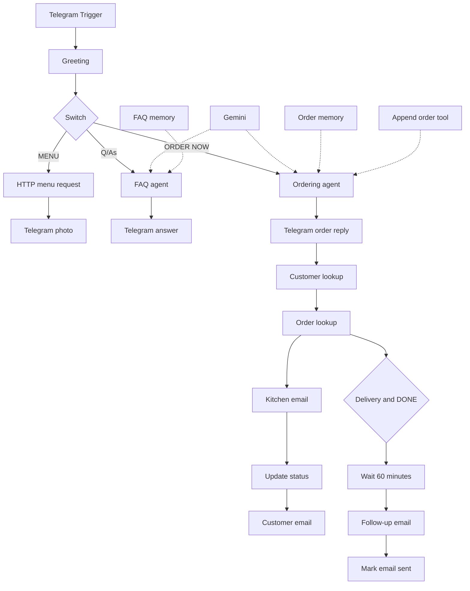

# Architecture

The latest export contains **33 nodes**: 28 service/logic nodes and five sticky notes. Telegram starts the customer conversation; a separate Google Sheets trigger starts feedback classification.

## Exported execution paths

The append tool is attached to the ordering agent. The downstream operations path follows the agent's reply; it needs a confirmed-order gate and filtered lookups before use. The `DONE` filter is not a separate completion listener.

## Feedback

`Google Sheets Trigger` → `FEEDBACK LLM Chain` → `Switch1`.

The same Gemini model serves the feedback chain and both agents. The Switch routes `NEGATIVE_KITCHEN` to kitchen email, `NEGATIVE_DELIVERY` to delivery email, and `NEGATIVE_BOTH` to manager email. The `POSITIVE` output is unconnected. No structured output parser or unknown-output fallback is configured.

## Implementation boundaries

- Menu prices and restaurant facts are embedded in prompts; there is no separate inventory or pricing service.
- Prompt confirmation instructions do not replace deterministic order validation or duplicate prevention.
- Fixed chat/session IDs, incomplete mappings, and feedback email templates require configuration.
- Runtime compatibility, OAuth access, webhooks, and model output need a configured n8n instance to verify.
- Original JSON exports remain unchanged in this documentation update.

See [SETUP.md](SETUP.md#configuration-gaps) for concrete findings and [DEMO.md](DEMO.md) for acceptance checks.
